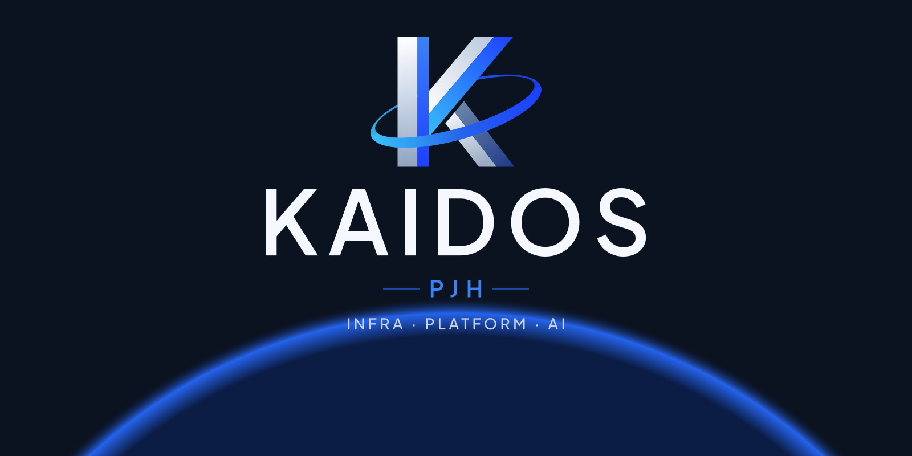
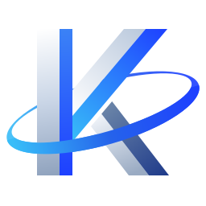

  

<h3 align="center">연결하고, 확장하는 가능성의 인프라.</h3>

Infrastructure · Platform · AI · Automation · Observability

  <a href="https://kaidos.click"><b>KAIDOS Engineering</b></a> ·
  <a href="https://djdakf1234.tistory.com/">이전 블로그 (Tistory)</a> ·
  <a href="https://www.linkedin.com/in/jeonghee-park-854032297/">LinkedIn</a>

---

## 👋 About

IDC 서버 운영에서 출발해 하이브리드 클라우드, 베어메탈 Kubernetes 플랫폼, GPU 인프라까지 다뤄 온 **DevOps / Platform Engineer**입니다.
기술을 고르기 전에 문제를 정의하고, 설계 근거와 검증 결과를 남겨 **다음 엔지니어도 같은 방식으로 재현할 수 있는 운영 기준**을 만드는 일을 좋아합니다.

## 🧭 다루는 영역

| 분야 | 키워드 |
|---|---|
| Kubernetes & Platform Engineering | RKE2 · Ansible · Cilium · Gateway API · Argo CD |
| DGX & GPU Infrastructure | DGX H100 · InfiniBand · NCCL · OpenTelemetry · Kueue |
| Observability | Prometheus · LGTM · OpenTelemetry · Hubble |
| AIOps & Automation | Platform Engineering · Automation · Multi-Agent |

## ✍️ KAIDOS Engineering

> 설계의 선택과 한계, 검증까지 남기는 엔지니어링 기록 — **[kaidos.click](https://kaidos.click)**

검수를 마친 글부터 차례로 공개하고 있습니다. 블로그 자체도 직접 설계·운영합니다.

- **Astro** 정적 사이트 · **Pages CMS**(Git 기반 웹 편집) · **Pagefind** 검색
- **AWS S3 + CloudFront(OAC) + Route 53**, Terraform으로 관리 · 월 운영비 1만 원 전후 목표
- **GitHub Actions + OIDC** 배포, 공개 게이트(초안·검수 승인·게시일) · E2E·접근성(WCAG 2.2 AA)·보안 회귀 테스트

## 📫 Contact

문의는 [KAIDOS Engineering](https://kaidos.click) 또는 [LinkedIn](https://www.linkedin.com/in/jeonghee-park-854032297/)으로 남겨 주세요.

